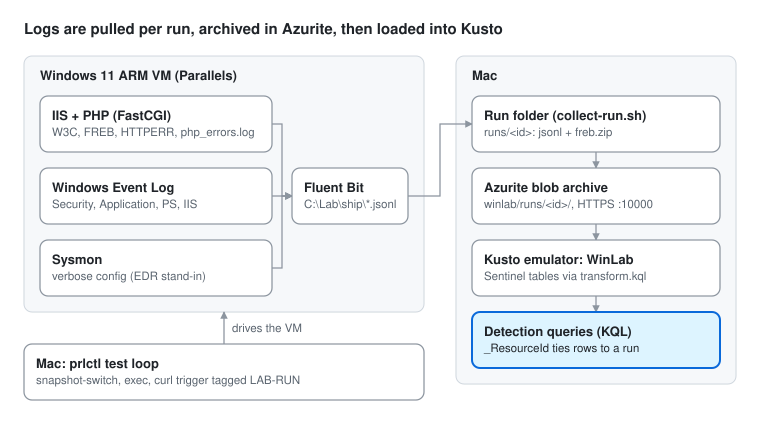

# php2shell research
{: .no_toc }

What a PHP vulnerability leaves in the logs on Windows, Linux and macOS, and which of those signals a detection pipeline actually receives.
{: .fs-6 .fw-300 }

Contents

{: .text-delta }
1. TOC
{:toc}

## Purpose and goals

This project records, per operating system, where each signal from a PHP vulnerability lands and whether a SIEM sees it. It is about logging and detection only: each test sends a harmless request that reaches the same code path or error class as the vulnerability. No working exploit is used or published.

For every signal it answers three questions:

1. Where does it land (file path or event channel)?
2. Is that source on by default?
3. Does it reach the SIEM, and what KQL finds it?

EDR records what processes do: process trees, file writes, network connections. It does not read PHP error logs. A PHP error reaches a SIEM only if a log shipper collects the file, or if PHP is told to write to the operating system's own log. That gap is what this project measures.

Windows is done first. Linux and macOS follow the same method.

## Highlights

First case: **CVE-2026-109618** — a memory-safety flaw in PHP's out-of-memory (OOM) handling, reachable through multipart request parsing (fixed in PHP 8.2.35 / 8.3.36 / 8.4.27 / 8.5.12). We do not touch the bug. We generate its **observable precondition** — a request that drives PHP to its memory limit — the ordinary way, and read the logs. The signal looks the same whether or not PHP is patched, so these detections work as a tripwire for the precondition regardless of version.

A request can drive PHP to OOM in two very different places, and they leave different traces:

| Finding | Where it shows up | On by default | Detection angle |
| --- | --- | --- | --- |
| OOM **during multipart parsing** logs `Allowed memory size ... exhausted ... in Unknown on line 0` — no script name or line, because it happens before any script runs | `PhpErrorLog_CL` (PHP error log) | PHP error logging off | Alert on a PHP fatal whose location is `Unknown on line 0`: that is a SAPI/parse-path OOM, not ordinary script code |
| The parse-path OOM **kills the FastCGI worker** (`php-cgi.exe` starts and dies within ~130 ms); a script OOM does not | `Event` (Sysmon 5 / 1), Security 4689 | Sysmon not installed; 4689 off | `php-cgi.exe` termination correlated with a POST that returns 500 |
| IIS records the parse-path OOM as **500 with a non-zero `win32status`** (observed 233 "pipe not connected" and 995 "operation aborted" — the worker's FastCGI pipe lost its process); a clean script OOM is 500 with `win32status` 0 | `W3CIISLog` | IIS log on (the `Win32Status` field is a default field) | `sc-win32-status != 0` on a 500 POST marks an aborted worker, distinct from an ordinary PHP 500 |
| An **oversized** multipart body is blocked by IIS request filtering (**413**, substatus 1) before PHP runs at all | `W3CIISLog` | On (≈30 MB `maxAllowedContentLength`) | A run of 413s on a POST endpoint = oversized-body probing, upstream of PHP |
| A plain **script-level** `memory_limit` OOM leaves **no process or EDR trace** — only the PHP log line and an IIS 500 | `PhpErrorLog_CL` + `W3CIISLog` | PHP log off | If PHP logging is off, the only signal is a bare IIS 500; the error is otherwise invisible |

{: .note }
Generated benignly: a deliberately low `memory_limit` plus either an in-script allocation or a large (but normal) multipart POST. No exploit, no payload — just PHP reaching its memory ceiling.

### Where the OOM error goes, by PHP logging mode

The same OOM, run under each `error_log` setting, lands in very different places:

| `error_log` (php.ini) | Case A — script OOM | Case B2 — parse-path OOM |
| --- | --- | --- |
| file (e.g. `php_errors.log`) | `PhpErrorLog_CL` | `PhpErrorLog_CL` |
| `syslog` | `Event` (Application) — real text in `EventData`, **not** the rendered description | `Event` — same |
| **unset (default)** | **lost** — no PHP error anywhere; only a bare IIS 500 remains | PHP text **lost**, but the worker death still shows: IIS non-zero `win32status`, Security 4689, Sysmon 5 |

**The key conclusion:** on a default PHP install the benign script-level OOM is almost invisible (a lone IIS 500), but the parse-path OOM — the one CVE-2026-109618 is about — stays detectable even with PHP error logging off, because it crashes the FastCGI worker. The dangerous case is the louder one.

Ready-to-run detections for these: [`kql/detections.kql`]({{ site.github.repository_url }}/blob/main/kql/detections.kql).

## Architecture and design choices

Provided for replication; the findings above do not depend on it. Full steps are in [Build steps](build/).

Design choices and why

| Choice | Why |
| --- | --- |
| VMs for Windows and macOS, not containers | Containers share the host kernel. On a Mac, Docker runs only Linux, inside a VM the host's EDR cannot see into. |
| Parallels Desktop | Snapshots and the `prlctl` command line make the revert, trigger, collect loop scriptable. |
| Windows 11 ARM on Apple Silicon | Same event channels, event IDs and IIS logs as x64. Emulating x86 is too slow. x64 PHP runs under Windows' built-in emulation. |
| Sysmon with a verbose config as the EDR stand-in | Records the same core events as Defender for Endpoint (process, network, file, registry, DNS) and keeps them locally. |
| Everything logged, then judged by default state | Every source is turned on so nothing is missed; the log source matrix then records which ones a default server has. |
| Fluent Bit in the VM, pulled per run | Each test run is collected as one unit. The VM holds no storage credentials. |
| Kusto emulator with real Sentinel table schemas | Queries written here run unchanged against `SecurityEvent`, `Event` and `W3CIISLog` in Microsoft Sentinel. |

## Log source matrix (Windows)

Most of the useful sources are off on a default Windows and IIS server, so a detection built on them needs that logging turned on first.

| Signal | Path or channel | On by default | Kusto table | Seen in test |
| --- | --- | --- | --- | --- |
| IIS request log | `C:\inetpub\logs\LogFiles\W3SVC1\u_ex*.log` | Yes (default fields only) | `W3CIISLog` | **yes** (A, B1, B2) |
| IIS request trace (FREB) | `C:\inetpub\logs\FailedReqLogFiles\W3SVC1\fr*.xml` | No | run archive (`freb.zip`) | **yes** (A: 5 traces, B2: 1) |
| http.sys rejects (HTTPERR) | `C:\Windows\System32\LogFiles\HTTPERR\httperr*.log` | Yes | `HttpErrLog_CL` | no (not generated; the 413 is IIS request filtering, logged in W3CIISLog) |
| PHP error log file | `error_log` path in php.ini | No (unset) | `PhpErrorLog_CL` | **yes** (A, B2) |
| PHP errors in Event Log | Application channel, `error_log = syslog` | No | `Event` | **yes** (syslog A, B2; text in EventData) |
| Process start with command line | Security 4688 | No | `SecurityEvent` | **yes** (4689 on the B2 worker exit) |
| Webroot file writes | Security 4663 (needs an audit rule) | No | `SecurityEvent` | not tested |
| Sysmon process, network, file, DNS | `Microsoft-Windows-Sysmon/Operational` | No (not installed) | `Event` | **yes** (B2 worker start/terminate) |
| PowerShell script blocks | PowerShell/Operational 4104 | Partly (suspicious blocks only) | `Event` | not tested |
| IIS configuration changes | `Microsoft-IIS-Configuration/Operational` | No | `Event` | not tested |
| Defender detections | `Microsoft-Windows-Windows Defender/Operational` | Yes | `Event` | not tested |

## Notes and challenges

Items marked **\*** affect what a detection can see. The rest are lab notes.

- **\*** A request that makes PHP log a warning still returns **HTTP 200**. The IIS log shows nothing unusual; the error exists only in the PHP log.
- **\*** With `error_log` unset (PHP's default), errors under IIS FastCGI may not be logged anywhere. Run C will confirm.
- **\*** `php-cgi.exe` stays running between requests under FastCGI. Process creation for it appears when the app pool starts, not per request, and any child process shows `php-cgi.exe` as its parent.
- **\*** IIS writes its log lazily: in testing, a line landed about 24 seconds after a flush request. Near-real-time detections on `W3CIISLog` see that delay.
- **\*** Most of the useful sources are off by default; see the matrix above.
- Sysmon stands in for Defender for Endpoint. MDE adds cloud-side analysis and event types such as AMSI and memory events.
- `Event.EventData` holds a JSON array in this lab; Azure Monitor Agent writes XML. Queries that parse `EventData` need adjusting for a real workspace.
- On Windows ARM, x64 PHP loads Prism emulation DLLs (`xtajit*.dll`), visible in Sysmon image-load events (ID 7). Nothing else differs from x64.
- **\*** To reach PHP's multipart parser, the body must be under IIS's `maxAllowedContentLength` (~30 MB by default); a larger body is answered with **413** by IIS request filtering before PHP runs. The two size regimes are different detections (413 vs the parse-path 500).
- **\*** The three OOM cases are distinguishable from the IIS log alone: GET/500/win32 0 (script OOM), POST/413 (oversized), POST/500/win32 non-zero (aborted worker). PHP error logging and Sysmon add confirmation but are not required.
- Under FastCGI, PHP's baseline `memory_get_usage(true)` is ~16 MB, so `memory_limit` for case B2 must leave headroom above that or `php-cgi.exe` fails to start (a different error).
- **\*** With `error_log = syslog`, PHP writes to the Windows Application log under an **unregistered source** (`PHP-8.4.27`), so the event's rendered description is a placeholder ("One or more arguments are invalid"). The real message is in the inserted strings (`EventData` / `StringInserts`) — detections must read those, not the description.
- Lab noise to filter out: processes started by `prl_tools_service.exe` (the lab's own remote commands) and the user agent `LAB-COLLECT-*` (the collector's marker request).

## Next: Linux and macOS

Both reuse this method: the same run modes, run-ID tagging, collection and one matrix per OS.

Where the signals are expected

**Linux:** Docker Compose with Apache + mod_php and nginx + php-fpm, plus a Linux VM with auditd and Sysmon for Linux for process telemetry.

| Signal | Where |
| --- | --- |
| Apache logs | `/var/log/apache2/` (Debian) or `/var/log/httpd/` (RHEL) |
| nginx logs | `/var/log/nginx/`; PHP errors appear as `FastCGI sent in stderr` |
| php-fpm | Pool log when `catch_workers_output = yes` |
| `error_log = syslog` | journald or rsyslog |
| Processes | auditd `execve`, Sysmon for Linux |

**macOS:** a macOS VM with Homebrew `php` plus `httpd` or `nginx`.

| Signal | Where |
| --- | --- |
| Apache and nginx logs | `/opt/homebrew/var/log/httpd/`, `/opt/homebrew/var/log/nginx/` |
| php-fpm | `/opt/homebrew/var/log/php-fpm.log` |
| `error_log = syslog` | Unified log: `log show --predicate 'process CONTAINS "php"'` |
| Processes | EDR built on Apple's Endpoint Security framework |

